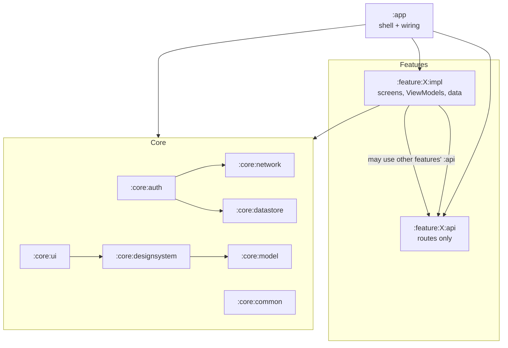
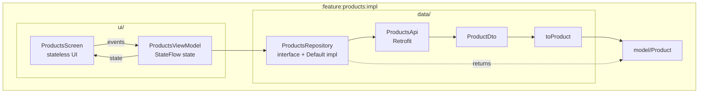

# 1. The big picture

## What this repository is

A **starter kit** for Android apps written in Kotlin with Jetpack Compose: an empty-but-complete app skeleton
(navigation, theming, networking, auth, storage, i18n, tests, CI, releases) plus seven **example features** that show
each part in use. A new project keeps the skeleton and deletes the examples (`scripts/remove-examples.sh`).

It is a port of a React Native boilerplate, so many choices mirror that project (token-based design system, an auth
adapter, English/Indonesian strings, Firebase App Distribution).

## The module map

The code is split into Gradle **modules**, in the style of Google's reference app Now in Android. Each box below is a
folder with its own `build.gradle.kts`.



| Module | Owns | Read first |
| --- | --- | --- |
| `:app` | `MainActivity`, the tab shell, `AppNavHost.kt` (the only place that connects features), the environment (flavours, API URL) | `app/src/main/java/com/primestrider/kotlinstarter/app/navigation/AppNavHost.kt` |
| `:core:designsystem` | colours, typography, spacing tokens, reusable components (buttons, fields, dialogs…) | `docs/architecture/design-system.md`, `docs/architecture/components.md` |
| `:core:ui` | screens shared by features: crash fallback, permission card, picture-in-picture | `core/ui/src/main/java/com/primestrider/kotlinstarter/core/permission/PermissionGate.kt` |
| `:core:network` | Retrofit/OkHttp clients, `ApiError`, `safeApiCall` | `docs/architecture/networking.md` |
| `:core:auth` | the session, bearer token, refresh on 401, the `AuthAdapter` seam | `docs/architecture/auth-session.md` |
| `:core:datastore` | small key/value preferences (theme, language) | `docs/architecture/storage-database.md` |
| `:core:common` | coroutine scope, formatters, language switching, crash recorder | |
| `:core:model` | types shared by several modules (`ThemeMode`) | |
| `:core:testing` | test helpers shared by modules' tests | `docs/architecture/testing.md` |
| `:feature:<name>:api` | the feature's routes, so others can navigate to it | |
| `:feature:<name>:impl` | everything else of the feature | `feature/products/impl` as the reference |

## The four rules

The structure exists to enforce a few rules. Because modules declare their dependencies, breaking a rule is a
**compile error**, not a code-review comment.

1. `core` never depends on `feature`. Shared code cannot accidentally grow feature knowledge.
2. A feature's `impl` never depends on another feature's `impl`, only on its `api` (its routes). Features stay
   independent and can be deleted one by one.
3. Only `:app` sees `impl` modules and wires them together.
4. Inside a feature, network and database types (DTOs, entities) stay in `data/` and are mapped to plain models
   before the UI sees them. A changed API response changes one mapper, not ten screens.

## Inside a feature



Packages: `data/` talks to the outside world, `model/` holds what the app works with, `ui/` draws it. The Hilt module
in `data/` binds the repository interface to its implementation, so tests can swap in a fake.

## The examples

| Feature | Demonstrates |
| --- | --- |
| `catalog` | Home with search and section chips, the Components tab, styling pages, a validated form |
| `products` | a paged REST list with debounced search, a detail page, an add-to-cart sheet |
| `todos` | a local Room database, filters, undo |
| `account` | sign-in against DummyJSON, a protected page, profile hub |
| `settings` | theme and language preferences |
| `devices` | 21 device APIs: camera, location, notifications, biometrics, files, background work… (`docs/examples.md`) |
| `animation` | motion patterns: cards, lists, page transitions, micro-interactions |

## Reading the code: how a module is declared

A feature module's whole build file is a few lines, because the shared setup lives in convention plugins in
`build-logic/`. This is `feature/todos/impl/build.gradle.kts` (abridged):

```kotlin
plugins {
    id("kotlinstarter.feature.impl")      // Android library + Compose + Hilt + core:designsystem/ui/common + navigation
}

android {
    namespace = "com.primestrider.kotlinstarter.feature.todos.impl"   // package of this module's R class
}

dependencies {
    api(projects.feature.todos.api)               // its own routes
    implementation(projects.feature.catalog.api)  // to put a "Todos" row on Home
    implementation(libs.androidx.room.runtime)    // libraries come from gradle/libs.versions.toml
    ksp(libs.androidx.room.compiler)              // code generation (Room DAOs)
}
```

- `id("kotlinstarter.feature.impl")` is defined in `build-logic/convention/src/main/kotlin/FeaturePlugins.kt`. It
  applies the Android library, Compose and Hilt plugins and adds the core modules every screen needs, so every feature
  module gets the same setup.
- `projects.feature.todos.api` is a type-safe reference to another module; a typo is a build error.
- There is no dependency on `:feature:products:impl`, so code in todos cannot import anything from products' screens
  or data: the class is simply not on its compile classpath. That is how rule 2 is enforced.

`settings.gradle.kts` lists every module (`include(":feature:todos:impl")` and so on). `:app` is the only module that
lists the `impl` modules in its dependencies (`app/build.gradle.kts`), inside `// region example:<feature>` blocks that
mark what the remove-examples script deletes.

Next: [From launch to pixels](02-from-launch-to-pixels.md).
