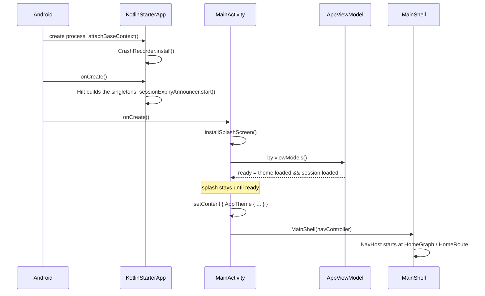
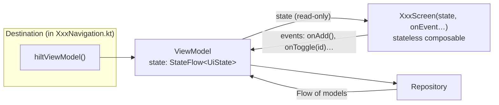

# 2. From launch to pixels

This chapter follows the app from the moment Android starts the process to the moment a list of todos is on screen,
and explains the pattern every screen in the repository follows.

## App start



### `KotlinStarterApp`: the process

`app/src/main/java/com/primestrider/kotlinstarter/KotlinStarterApp.kt`

```kotlin
@HiltAndroidApp
class KotlinStarterApp : Application(), Configuration.Provider {
    @Inject lateinit var sessionExpiryAnnouncer: SessionExpiryAnnouncer
    @Inject lateinit var workerFactory: HiltWorkerFactory

    override val workManagerConfiguration: Configuration
        get() = Configuration.Builder().setWorkerFactory(workerFactory).build()

    override fun attachBaseContext(base: Context) {
        super.attachBaseContext(base)
        CrashRecorder(base).install()
    }

    override fun onCreate() {
        super.onCreate()
        sessionExpiryAnnouncer.start()
    }
}
```

- `Application` is created once per process, before any screen. `@HiltAndroidApp` turns it into the root of the
  dependency-injection graph: from here on, any class whose constructor is marked `@Inject` can be created by Hilt.
- `attachBaseContext` runs even earlier than `onCreate`. Installing the crash recorder there means a crash while the
  app is still starting is recorded too; the next launch shows `CrashFallbackScreen` instead of crashing again.
- `sessionExpiryAnnouncer.start()` begins listening for "the session was lost" so the user gets a message, whatever
  screen is open (chapter 3).
- `workManagerConfiguration` lets background jobs (`@HiltWorker`) get injected dependencies.

> **In React/Vue:** this is the code before `createRoot(...).render(<App/>)` / `createApp(App).mount()`: global error
> handlers (`window.onerror`, `app.config.errorHandler`), creating stores and services. Unlike a browser tab, Android
> can kill and recreate this process at any time, so nothing here may assume it runs only once per "visit".

### `MainActivity`: the window

`app/src/main/java/com/primestrider/kotlinstarter/app/MainActivity.kt` (abridged)

```kotlin
@AndroidEntryPoint
class MainActivity : AppCompatActivity() {
    private val viewModel: AppViewModel by viewModels()

    override fun onCreate(savedInstanceState: Bundle?) {
        val splash = installSplashScreen()
        super.onCreate(savedInstanceState)
        splash.setKeepOnScreenCondition { !viewModel.ready.value }
        enableEdgeToEdge()
        setContent {
            val navController = rememberNavController()
            val mode = viewModel.themeMode.collectAsState().value ?: ThemeMode.SYSTEM
            val darkTheme = resolveDarkTheme(mode, isSystemInDarkTheme())
            AppTheme(darkTheme = darkTheme) {
                CompositionLocalProvider(LocalMessenger provides messenger, /* … */) {
                    val crash = viewModel.lastCrash.collectAsState().value
                    if (crash != null) CrashFallbackScreen(crash, onContinue = viewModel::dismissCrash)
                    else PictureInPictureFrame(/* … */) { MainShell(navController) }
                }
            }
        }
    }
}
```

- The app has **one** activity; every page is a Compose destination inside it.
- `by viewModels()` gets the `AppViewModel` for this activity. It survives rotation: Android destroys and recreates the
  activity, but hands back the same ViewModel.
- The splash screen stays up until `ready` is true, i.e. the stored theme and session have been read from disk. That
  is why the app never flashes the wrong theme or a "signed out" state for a frame.
- `setContent { … }` is where Compose starts. Everything inside is a tree of composable functions.
- `collectAsState()` subscribes the UI to a `StateFlow`; when the stored theme changes (e.g. from Settings), the
  value changes and Compose redraws everything that read it.
- `CompositionLocalProvider` makes the `Messenger` (snackbar messages) available to every composable below it without
  passing it through every function.

> **In React/Vue:** `setContent` is `root.render(<App/>)`. `AppTheme` plays the role of a `ThemeProvider` /
> `provide('theme')`. `CompositionLocalProvider` is React Context or Vue `provide`/`inject`. The splash condition is the
> "loading" gate you would put around the router while `localStorage` and the session are restored.

## The pattern every screen follows



The rule is **unidirectional data flow**: state goes down, events go up.

- The **Screen** is a plain function of its inputs. It never fetches data, never holds business state, and can be
  previewed or tested with any state you give it.
- The **ViewModel** owns the state, as one immutable `UiState` data class exposed through a `StateFlow`, and has one
  public function per user action.
- The **destination** (in the feature's `…Navigation.kt`) connects the two: it gets the ViewModel with
  `hiltViewModel()`, collects its state and passes ViewModel functions as callbacks.

### Reading the todos screen

The state, `feature/todos/impl/src/main/java/com/primestrider/kotlinstarter/feature/example/todos/ui/TodosViewModel.kt`:

```kotlin
data class TodosUiState(
    val input: String,
    @StringRes val inputError: Int?,
    val filter: TodoFilter,
    val todos: List<Todo>,
    val done: Int,
    val total: Int,
    val loaded: Boolean = true,
)
```

Everything the screen can show is in this one immutable object. A screen bug is then usually "the ViewModel produced
the wrong state" (testable without UI) or "the screen drew this state wrong" (testable without a ViewModel).

The ViewModel builds that state by **combining** sources:

```kotlin
@HiltViewModel
class TodosViewModel @Inject constructor(
    private val repository: TodosRepository,
    private val savedStateHandle: SavedStateHandle,
    private val messenger: Messenger,
) : ViewModel() {
    val state: StateFlow<TodosUiState> =
        combine(
            savedStateHandle.getStateFlow(INPUT_KEY, ""),
            savedStateHandle.getStateFlow(SUBMITTED_KEY, false),
            savedStateHandle.getStateFlow(FILTER_KEY, TodoFilter.ALL),
            repository.todos.onStart<List<Todo>?> { emit(null) },
        ) { input, submitted, filter, stored ->
            val all = stored.orEmpty()
            TodosUiState(
                input = input,
                inputError = if (submitted) validateTodoTitle(input) else null,
                filter = filter,
                todos = when (filter) {
                    TodoFilter.ALL -> all
                    TodoFilter.ACTIVE -> all.filterNot { it.done }
                    TodoFilter.DONE -> all.filter { it.done }
                },
                done = all.count { it.done },
                total = all.size,
                loaded = stored != null,
            )
        }.stateIn(viewModelScope, SharingStarted.Eagerly, /* initial */ TodosUiState(/* … */ loaded = false))
```

- `@HiltViewModel` + `@Inject constructor(...)`: Hilt supplies the repository (bound to the Room implementation in
  `TodosModule`), a `SavedStateHandle` and the `Messenger`.
- `SavedStateHandle` holds the text being typed and the filter. Android saves it when it kills the app in the
  background and restores it when the user comes back, so the draft survives **process death**, which a browser never
  does to a tab.
- `repository.todos` is a `Flow<List<Todo>>` straight from Room: whenever the table changes, it emits the new list.
  There is no "refetch after insert" code anywhere; the database pushes changes.
- `combine { … }` recomputes the state whenever any source changes: the filtered list and the counters are derived,
  never stored twice.
- `onStart { emit(null) }` + `loaded = stored != null` distinguishes "no todos" from "not loaded yet", so the empty
  state does not flash on open.
- `stateIn(viewModelScope, …)` turns the flow into a `StateFlow` with a current value that lives as long as the
  ViewModel.

An action:

```kotlin
fun add() {
    val title = savedStateHandle.get<String>(INPUT_KEY).orEmpty()
    savedStateHandle[SUBMITTED_KEY] = true
    if (validateTodoTitle(title) != null) return
    savedStateHandle[INPUT_KEY] = ""          // clear first, so a double tap cannot add twice
    savedStateHandle[SUBMITTED_KEY] = false
    write(onFailure = { savedStateHandle[INPUT_KEY] = title }) {
        repository.add(title)
        messenger.success(UiText.Resource(R.string.todos_added))
    }
}
```

The function only changes inputs (the saved draft) and calls the repository. It never touches the list: Room emits the
new row, `combine` builds the new state, the screen redraws. `write { }` launches a coroutine (an async task tied to the
ViewModel's lifetime) and turns a database error into a message instead of a crash.

The screen, `TodosScreen.kt`, receives that state and plain callbacks:

```kotlin
@Composable
fun TodosScreen(
    state: TodosUiState,
    onInputChange: (String) -> Unit,
    onAdd: () -> Unit,
    onToggle: (String) -> Unit,
    onRemove: (String) -> Unit,
    onClearCompleted: () -> Unit,
    onFilterChange: (TodoFilter) -> Unit,
    onBack: () -> Unit,
) {
    var pendingDelete by rememberSaveable { mutableStateOf<String?>(null) }
    AppScaffold(title = stringResource(R.string.todos_title), onBack = onBack) { padding -> /* … */ }
}
```

- The only local state is `pendingDelete` (which confirmation dialog is open): pure UI state, kept in the composable
  with `rememberSaveable` (survives rotation and process death).
- `stringResource(R.string.todos_title)` reads a translated string of this module (see `docs/architecture/i18n.md`).

And the destination that ties them together, `TodosNavigation.kt`:

```kotlin
fun NavGraphBuilder.todosDestinations(navController: NavController) {
    composable<TodosRoute> {
        val viewModel: TodosViewModel = hiltViewModel()
        val state by viewModel.state.collectAsStateWithLifecycle()
        TodosScreen(
            state = state,
            onInputChange = viewModel::onInputChange,
            onAdd = viewModel::add,
            /* … */
            onBack = { navController.popBackStack() },
        )
    }
}
```

`collectAsStateWithLifecycle()` stops collecting while the app is in the background, so a hidden screen does no work.

> **In React/Vue:** `TodosUiState` is the shape your selector or computed returns; the ViewModel is a store
> (Redux slice + selectors, Zustand store, Pinia store) scoped to one page; `combine` is `createSelector` /
> `computed()`; `TodosScreen` is a presentational component that receives props and emits callbacks; the destination is
> the "container" (`const state = useTodosStore()` then `<TodosScreen {...state} onAdd={store.add}/>`). The difference:
> the store dies with the page's back-stack entry, not with the component, and part of it is persisted automatically
> across process death.

## Compose in five rules

1. A composable is a function; calling it emits UI. There is no template and no JSX: `if`, `for`, `when` are plain
   Kotlin.
2. Compose re-runs (recomposes) a function when a `State` it read changes. Only the parts that read the changed value
   run again.
3. `remember { }` keeps a value across recompositions; `rememberSaveable { }` also across rotation and process death.
4. Side effects go in effect handlers: `LaunchedEffect(key) { }` (runs a coroutine when `key` changes),
   `DisposableEffect(key) { onDispose { } }` (setup + cleanup). `MainActivity` uses both.
5. Layout is composables too: `Column`, `Row`, `Box`, `LazyColumn`, with a `Modifier` chain for size, padding, clicks and
   semantics (accessibility).

Next: [Data, network and auth](03-data-network-auth.md).
