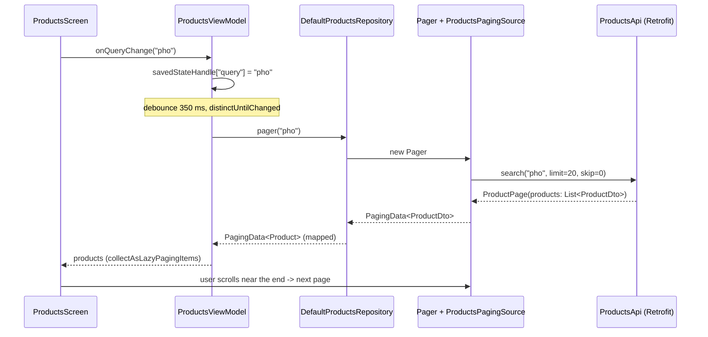
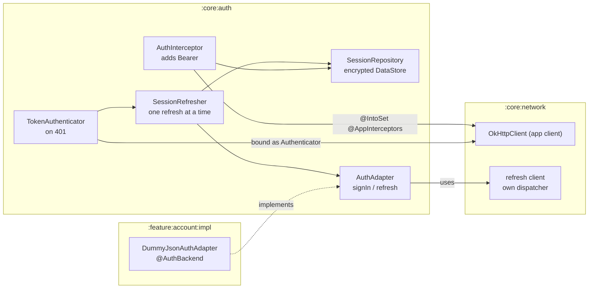
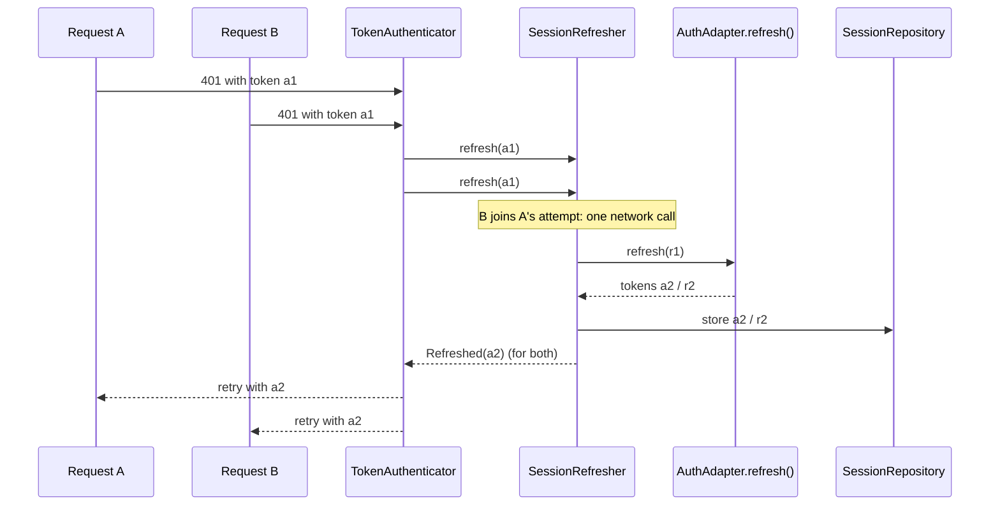

# 3. Data, network and auth

Where data comes from, how it reaches a ViewModel, and how the session and access token are handled without any screen
having to think about them.

## The three stores

| Data | Store | Example in the repo |
| --- | --- | --- |
| Server data | REST API through Retrofit | products (`feature/products/impl`) |
| Local records you list and query | Room (SQLite) | todos (`ExampleDatabase`), the devices SQLite demo (`DevicesDatabase`) |
| A few settings | DataStore Preferences | theme, language (`core/datastore`) |
| Secrets | DataStore + Android Keystore encryption | the session tokens (`core/auth`) |

Every one of them is read through a **repository** that returns Kotlin `Flow`s or `suspend` functions of plain models.

> **In React/Vue:** the repository is your API/service layer (`api/products.ts`, a TanStack Query hook factory, a Pinia
> action that calls axios). Room replaces IndexedDB / an ORM over SQLite; DataStore replaces `localStorage`; the
> Keystore-encrypted session replaces "httpOnly cookie or encrypted storage", which a browser gives you and a phone app
> must build.

## Remote data: the products feature



### The ViewModel: search as a pipeline

`feature/products/impl/src/main/java/com/primestrider/kotlinstarter/feature/example/products/ui/ProductsViewModel.kt`

```kotlin
@HiltViewModel
class ProductsViewModel @Inject constructor(
    repository: ProductsRepository,
    private val savedStateHandle: SavedStateHandle,
) : ViewModel() {
    val query: StateFlow<String> = savedStateHandle.getStateFlow(QUERY_KEY, "")

    fun onQueryChange(value: String) {
        savedStateHandle[QUERY_KEY] = value
    }

    private val initialQuery = query.value.trim()

    val products: Flow<PagingData<Product>> =
        query
            .map { it.trim() }
            .debounce { if (it == initialQuery) 0L else SEARCH_DEBOUNCE_MILLIS }
            .distinctUntilChanged()
            .flatMapLatest(repository::pager)
            .cachedIn(viewModelScope)
}
```

Read it top to bottom as a pipeline over the query text:

- `debounce`: wait for a pause in typing (but load the restored query at once after rotation).
- `distinctUntilChanged`: typing "a", then backspace and "a" again does not reload.
- `flatMapLatest`: start a new paged search for the new query and **cancel** the previous one, so an old slow response
  can never overwrite a newer one.
- `cachedIn(viewModelScope)`: loaded pages survive rotation.

> **In React/Vue:** this is `useDebouncedValue(query)` + `useInfiniteQuery(['products', debounced], …)` with
> `AbortController` cancelling the stale request, or a Vue `watchDebounced` feeding a store action. Here the whole
> behaviour is five operators on one stream.

### The repository: the boundary between API and app

`feature/products/impl/src/main/java/com/primestrider/kotlinstarter/feature/example/products/data/ProductsRepository.kt`

```kotlin
interface ProductsRepository {
    fun pager(query: String): Flow<PagingData<Product>>
    suspend fun product(id: Long): Product
}

class DefaultProductsRepository @Inject constructor(
    private val api: ProductsApi,
    private val json: Json,
) : ProductsRepository {
    override fun pager(query: String): Flow<PagingData<Product>> =
        Pager(PagingConfig(pageSize = PAGE_SIZE, initialLoadSize = PAGE_SIZE, enablePlaceholders = false)) {
            ProductsPagingSource(api, query, json)
        }.flow.map { page -> page.map { it.toProduct() } }

    override suspend fun product(id: Long): Product = api.product(id).toProduct()
}
```

- The interface is what the ViewModel sees; `ProductsModule` binds it to `DefaultProductsRepository` with `@Binds`.
  Tests pass `FakeProductsRepository` instead (`ProductFixtures.kt`), no server needed.
- `toProduct()` (`ProductMappers.kt`) turns the API shape (`ProductDto`) into the app's `Product`. The DTO never leaves
  `data/`; `ProductsArchitectureTest` fails if a screen mentions a `…Dto`.

The API itself is an annotated interface; Retrofit generates the HTTP code (`ProductsApi.kt`):

```kotlin
interface ProductsApi {
    @Anonymous
    @GET("products/search")
    suspend fun search(@Query("q") query: String, @Query("limit") limit: Int, @Query("skip") skip: Int): ProductPage
}
```

`@Anonymous` means "public endpoint": no bearer token, no refresh on 401 (see below).

> **In React/Vue:** `ProductsApi` is what you would write as `export const searchProducts = (q, limit, skip) =>
> http.get('products/search', { params: { q, limit, skip } })`, except the types are checked against the JSON at runtime
> by kotlinx serialization (`@Serializable data class ProductDto`), like a zod schema on every response.

### Errors

`core/network/src/main/java/com/primestrider/kotlinstarter/core/network/ApiError.kt`

```kotlin
data class ApiError(
    val message: String?,          // the server's "message" field, when it sent one
    val status: Int? = null,       // HTTP status
    val isNetworkError: Boolean = false,
    val data: JsonElement? = null, // the whole error body, e.g. per-field validation errors
)

suspend fun <T> safeApiCall(json: Json, block: suspend () -> T): ApiResult<T> =
    try {
        ApiResult.Success(block())
    } catch (e: CancellationException) {
        throw e
    } catch (e: HttpException) {
        ApiResult.Failure(e.toApiError(json))
    } catch (e: IOException) {
        ApiResult.Failure(e.toApiError(json))
    } catch (e: SerializationException) {
        ApiResult.Failure(e.toApiError(json))
    }
```

Every failure (HTTP status, no network, unexpected JSON) becomes one `ApiError`; `ApiError.userMessage()` turns it into
a localized text. `CancellationException` is rethrown: a cancelled coroutine (the user left the page) is not an error.

## Local data: Room

The todos feature keeps its rows in SQLite through Room:

- `TodoEntity` (`@Entity(tableName = "todos")`) is the row; `TodoDao` declares queries as annotated functions
  (`@Query("SELECT * FROM todos ORDER BY createdAt DESC") fun observeAll(): Flow<List<TodoEntity>>`), and Room
  generates the code at build time.
- `ExampleDatabase` (`example.db`) lists the entities and its version. When the schema changes, the version goes up and
  a `Migration` moves existing data (`MIGRATION_1_2`, `MIGRATION_2_3`); exported schema files in
  `feature/todos/impl/schemas/` let tests replay every migration (`ExampleDatabaseMigrationTest`).
- `DefaultTodosRepository` maps `TodoEntity` to the `Todo` model, and returns a `Flow` that emits again whenever the
  table changes. That is why chapter 2's ViewModel never reloads after adding a todo.

> **In React/Vue:** there is no direct equivalent in a browser app; the closest is IndexedDB with Dexie's
> `liveQuery()`, which also re-emits on change. Migrations are what you know from a backend ORM (Prisma, TypeORM),
> except here they run on the user's phone the first time the new version opens the file.

## Settings: DataStore

`core/datastore/src/main/java/com/primestrider/kotlinstarter/core/datastore/DataStoreModule.kt` provides two
DataStore files: `settings` (theme, language) and `session` (the encrypted session). File names are constants in
`DataStoreFiles`, because renaming one would lose every user's settings on update. `ThemePreferenceRepository` exposes
`themeMode: Flow<ThemeMode>` and `suspend fun setThemeMode(...)`; `AppViewModel` reads it before the first frame.

## The session and the access token



### How auth plugs into the network client

`core:network` does not know `core:auth` (that would be a dependency cycle). It builds the app client from whatever
other modules contribute, `core/network/src/main/java/com/primestrider/kotlinstarter/core/network/NetworkModule.kt`:

```kotlin
@Provides
@Singleton
fun okHttpClient(
    @AppInterceptors interceptors: Set<@JvmSuppressWildcards Interceptor>,
    authenticator: Optional<Authenticator>,
): OkHttpClient =
    baseClient()
        .apply { interceptors.forEach(::addInterceptor) }
        .apply { authenticator.ifPresent(::authenticator) }
        .build()
```

and `core:auth` contributes, `core/auth/src/main/java/com/primestrider/kotlinstarter/core/auth/AuthModule.kt`:

```kotlin
@Binds @IntoSet @AppInterceptors
abstract fun bindAuthInterceptor(impl: AuthInterceptor): Interceptor

@Binds
abstract fun bindAuthenticator(impl: TokenAuthenticator): Authenticator
```

`@IntoSet` adds to a set that any module may extend (a Hilt "multibinding"); `Optional<Authenticator>` is present only
when some module binds one. Remove `core:auth` and the client still builds, without auth.

### Adding the token

`AuthInterceptor.kt`:

```kotlin
override fun intercept(chain: Interceptor.Chain): Response {
    val request = chain.request()
    val token = repository.accessToken()
    if (token == null || !request.isForApi(apiUrl) || request.isAnonymous()) return chain.proceed(request)
    return chain.proceed(request.newBuilder().header(AUTHORIZATION, bearer(token)).build())
}
```

The token is added only when signed in, only for the API's own origin (scheme, host and port: an image CDN never sees
it) and never for `@Anonymous` calls.

### Refreshing on 401



`TokenAuthenticator.kt`:

```kotlin
override fun authenticate(route: Route?, response: Response): Request? {
    val request = response.request
    if (!request.isForApi(apiUrl) || request.isAnonymous() || response.priorResponse != null) return null
    val failedToken = bearerToken(request.header(AUTHORIZATION)) ?: return null
    return when (val outcome = refresh(failedToken)) {
        is RefreshOutcome.Refreshed -> request.newBuilder().header(AUTHORIZATION, bearer(outcome.accessToken)).build()
        RefreshOutcome.SignedOut -> null
        RefreshOutcome.NetworkFailure -> throw IOException("Token refresh failed: network")
    }
}
```

- OkHttp calls `authenticate` after a 401; returning a request retries it, returning `null` gives up.
- `priorResponse != null` means "this was already a retry": no endless loop.
- `SessionRefresher` makes concurrent 401s share **one** refresh (`inFlight` deferred), and refuses to retry a request
  with a token from a previous session (another user signed in meanwhile).
- `SignedOut`: the refresh token was rejected; the session is cleared and `SessionExpiryAnnouncer` shows "Your session
  has expired" wherever the user is. A network failure keeps the session.

The only backend-specific code is the `AuthAdapter` (`signIn`, `refresh`). The account example binds
`DummyJsonAuthAdapter` with `@Binds @AuthBackend`; without such a binding `NotConfiguredAuthAdapter` is used and
sign-in reports that it is not set up. Details: `docs/architecture/auth-session.md`.

> **In React/Vue:** this is the axios interceptor pair every SPA writes: a request interceptor that adds
> `Authorization`, and a response interceptor that, on 401, awaits a shared `refreshPromise`, retries the queued
> requests, and logs out when the refresh fails. The logic is the same; OkHttp gives the two hooks (`Interceptor`,
> `Authenticator`) and the token lives in Keystore-encrypted storage instead of memory/cookies.

Next: [Navigation](04-navigation.md).
