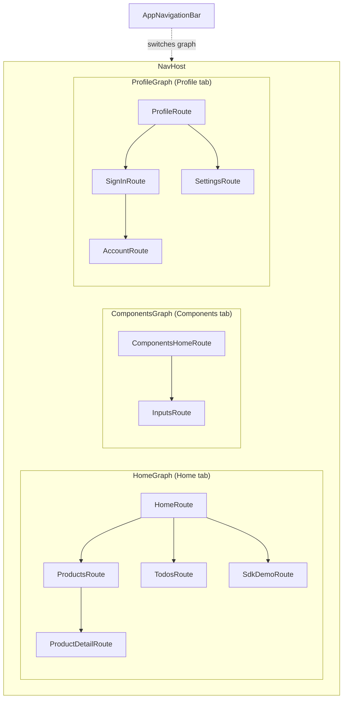
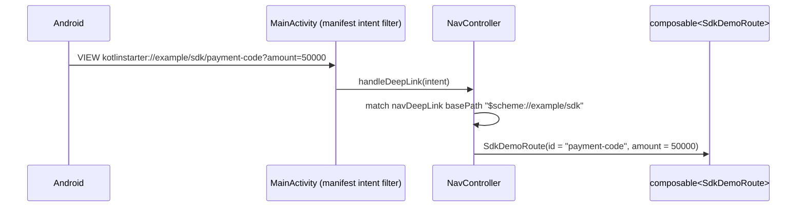

# 4. Navigation

How screens are named, how the bottom tabs work, how a feature adds its pages without `:app` knowing their insides,
and how a link from outside the app opens a screen.

## Routes are types

A route is a `@Serializable` Kotlin object or class, declared in the feature's `:api` module.
`feature/products/api/src/main/java/com/primestrider/kotlinstarter/feature/example/ProductsRoutes.kt`:

```kotlin
@Serializable
data object ProductsRoute

@Serializable
data class ProductDetailRoute(
    val id: Long,
)
```

- Navigating is `navController.navigate(ProductDetailRoute(id = 42))`; the destination reads
  `entry.toRoute<ProductDetailRoute>().id`. A missing or mistyped argument is a compile error.
- Navigation stores the route's serial name (its qualified class name) in the saved back stack. That is why the
  example routes keep the package `com.primestrider.kotlinstarter.feature.example` in every module, and why
  `RouteNamesTest` pins all of them: renaming a shipped route would break restoring the app after process death.

> **In React/Vue:** this replaces path strings (`/products/:id`) with a typed object. React Router's
> ``navigate(`/products/${id}`)`` + `useParams()` becomes `navigate(ProductDetailRoute(id))` + `toRoute()`; Vue Router's
> named routes with `params` are the closest relative.

## The shell: tabs with their own history



`app/src/main/java/com/primestrider/kotlinstarter/app/navigation/MainShell.kt` puts a `Scaffold` with the bottom bar
around one `NavHost` holding a nested graph per tab. Switching tab saves the current tab's back stack and restores the
target's; re-selecting a tab pops it to its start; back at the root of another tab returns to Home. With only one tab
(after removing the examples) the bottom bar hides.

The tab list is data, `AppNavHost.kt`:

```kotlin
val HomeTab = TopLevelTab(R.string.nav_home, Icons.Filled.Home, HomeGraph, HomeRoute, HomeGraph::class)

val topLevelTabs: List<TopLevelTab> =
    buildList {
        add(HomeTab)
        // region example:catalog
        add(TopLevelTab(R.string.nav_components, Icons.AutoMirrored.Filled.List, ComponentsGraph, ComponentsHomeRoute, ComponentsGraph::class))
        // endregion
        // region example:account
        add(TopLevelTab(R.string.nav_profile, Icons.Filled.Person, ProfileGraph, ProfileRoute, ProfileGraph::class))
        // endregion
    }
```

The `// region example:<feature>` comments are not decoration: `scripts/remove-examples.sh` deletes those blocks, and
because the list is built with `buildList`, the code still compiles with any block removed.

> **In React/Vue:** each tab is like a nested router outlet whose history is kept while you are on another tab (what
> `<KeepAlive>` + per-tab history would give you in Vue, or a tab navigator in React Native). The web has one history
> for the whole page; Android apps traditionally keep one per tab.

## How a feature plugs in

`:app` never registers a feature's screens itself. Each feature exposes one function, and `:app` calls it inside the
right tab, `AppNavHost.kt`:

```kotlin
fun NavGraphBuilder.homeGraph(navController: NavHostController, screens: List<HomeScreenContent> = homeScreens) {
    navigation<HomeGraph>(startDestination = HomeRoute) {
        composable<HomeRoute> {
            val home = screens.firstOrNull()
            if (home == null) PlaceholderHomeScreen() else home { route -> navController.navigate(route) }
        }
        // region example:products
        productsDestinations(navController)
        // endregion
        // region example:todos
        todosDestinations(navController)
        // endregion
        // …
    }
}
```

and the products feature registers its own pages,
`feature/products/impl/src/main/java/com/primestrider/kotlinstarter/feature/example/products/ui/ProductsNavigation.kt`:

```kotlin
fun NavGraphBuilder.productsDestinations(navController: NavController) {
    composable<ProductsRoute> {
        val viewModel: ProductsViewModel = hiltViewModel()
        val query by viewModel.query.collectAsStateWithLifecycle()
        ProductsScreen(
            query = query,
            onQueryChange = viewModel::onQueryChange,
            products = viewModel.products.collectAsLazyPagingItems(),
            onOpen = { id -> navController.navigate(ProductDetailRoute(id)) },
            onBack = { navController.popBackStack() },
        )
    }
    composable<ProductDetailRoute> { /* … */ }
}
```

`hiltViewModel()` creates the ViewModel scoped to this back-stack entry: it lives while the page is in the history and
is cleared when the page is popped.

### Home is built from contributions

The Home list is not hard-coded either. Each feature contributes rows through Hilt, and the catalog renders whatever is
contributed, `feature/products/impl/src/main/java/com/primestrider/kotlinstarter/feature/example/products/data/ProductsModule.kt`:

```kotlin
@Provides
@IntoSet
fun homeEntry(): CatalogEntry =
    CatalogEntry(R.string.products_title, R.string.products_subtitle, ProductsRoute, CatalogSections.FEATURES, order = 10)
```

`HomeViewModel` (in the catalog feature) receives `Set<CatalogSection>` and `Set<CatalogEntry>`, sorts them and hands the
result to `HomeScreen`. Delete a feature and its rows are gone; no list to edit.

> **In React/Vue:** this is a plugin registry: each feature module calls `registerHomeEntry({...})` at import time, or
> exports a `routes` array that the app spreads into the router. Hilt's `@IntoSet` does it at compile time.

## Protected pages

`AccountRoute` must only show with a session. The guard lives in the destination,
`feature/account/impl/src/main/java/com/primestrider/kotlinstarter/feature/example/auth/AccountNavigation.kt`:

```kotlin
composable<AccountRoute> {
    val viewModel: AccountViewModel = hiltViewModel()
    val session by viewModel.session.collectAsStateWithLifecycle()
    val signingOut by viewModel.signingOut.collectAsStateWithLifecycle()
    val loaded by viewModel.loaded.collectAsStateWithLifecycle()
    val current = session
    LaunchedEffect(viewModel) {
        viewModel.signedOut.collect { navController.popBackStack(ProfileRoute, inclusive = false) }
    }
    LaunchedEffect(loaded, current == null, signingOut) {
        if (loaded && current == null && !signingOut) {
            navController.navigate(SignInRoute) { popUpTo<AccountRoute> { inclusive = true } }
        }
    }
    if (current != null) AccountScreen(session = current, /* … */)
}
```

- Nothing is decided before the stored session has loaded (`loaded`): after process death the page waits instead of
  bouncing to sign-in.
- A session that disappears without the user signing out (expiry) replaces Account with sign-in, so Back cannot return
  to it. A deliberate sign-out goes back to the Profile hub.

> **In React/Vue:** the same as a `<RequireAuth>` wrapper or a `beforeEach` guard, with one extra case a SPA rarely
> handles: the page itself being restored by the OS while the session is still loading.

## Deep links

A link like `kotlinstarter://example/sdk/payment-code?amount=50000` (dev builds use `kotlinstarter-dev://…`) opens a
screen directly:



The scheme is set per flavour in `app/build.gradle.kts` and published in the manifest. The devices feature registers
the pattern with `navDeepLink<SdkDemoRoute>(basePath = "$appScheme://example/sdk")`, and the route's fields become path
and query parameters. Code that builds such links (notifications, the browser demo) reads the scheme with
`AppConfig.appScheme(context)`.

Next: [Build, test and ship](05-build-test-ship.md).
