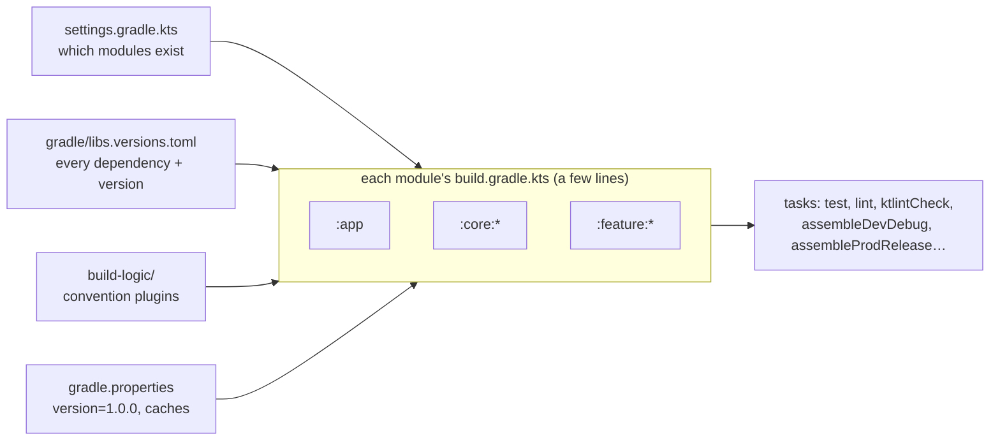
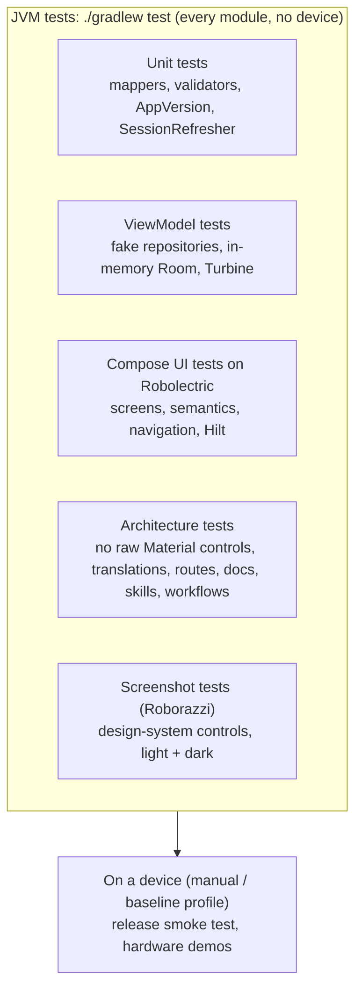
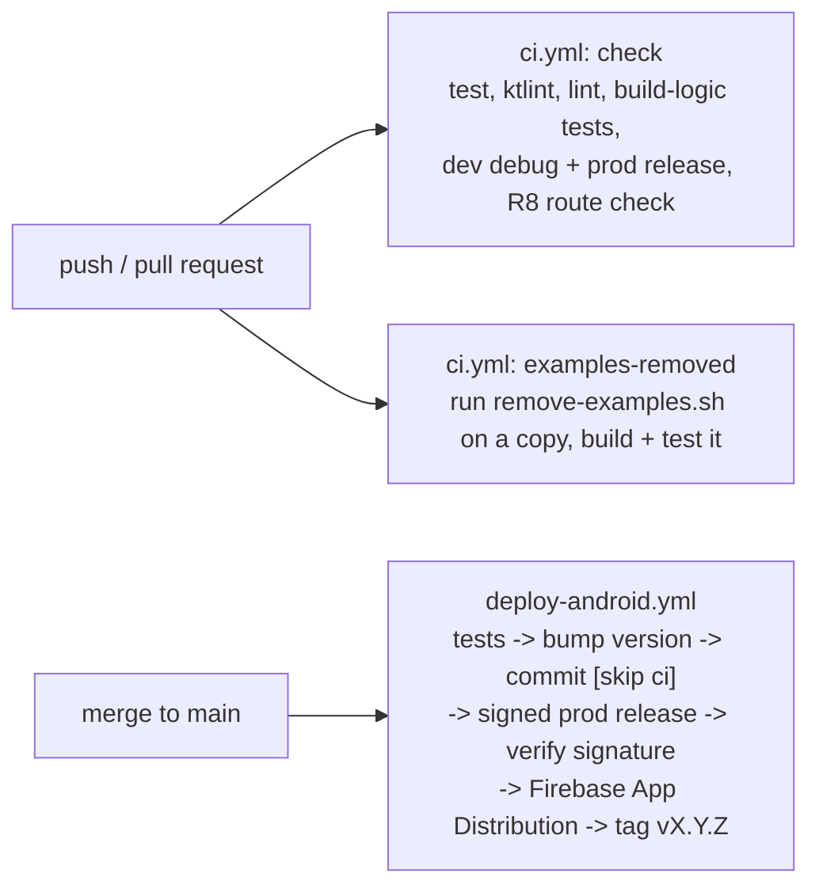

# 5. Build, test and ship

What happens between "I changed a file" and "a tester has the app": Gradle, the shared build setup, flavours, the test
pyramid, CI and the release pipeline.

## Gradle in one diagram



- `gradle/libs.versions.toml` is the single list of libraries and versions; build files refer to them as
  `libs.androidx.room.runtime`.
- `build-logic/` is a small Gradle project of its own. Its convention plugins (`kotlinstarter.android.library`,
  `kotlinstarter.feature.impl`, `kotlinstarter.hilt`, …) hold the setup every module shares, defined in
  `build-logic/convention/src/main/kotlin/Plugins.kt` and `FeaturePlugins.kt`, with SDK levels in `AndroidConfig.kt`.
- Parallel builds, the build cache and the configuration cache are on (`gradle.properties`), so a second build only
  redoes what changed.

> **In React/Vue:** `libs.versions.toml` is `package.json` (+ lockfile discipline) for the whole monorepo;
> `settings.gradle.kts` is the workspaces list (`pnpm-workspace.yaml`, Nx/Turborepo projects); convention plugins are
> a shared `tsconfig.base.json` / ESLint / Vite config preset that each package extends; Gradle tasks are npm scripts,
> but with dependency graph, caching and incremental builds built in (like Turborepo/Nx).

## Variants: flavours and build types

| | `debug` | `release` |
| --- | --- | --- |
| `dev` | daily work: `assembleDevDebug`; id `com.primestrider.kotlinstarter.dev`, version `1.0.0-dev`, scheme `kotlinstarter-dev` | rarely needed |
| `prod` | rarely needed | what testers and users get: R8 minified, resources shrunk, signed with the release key |

From `app/build.gradle.kts`:

```kotlin
productFlavors {
    create("dev") {
        dimension = "environment"
        applicationIdSuffix = ".dev"
        versionNameSuffix = "-dev"
        manifestPlaceholders["appScheme"] = "$appScheme-dev"
        buildConfigField("String", "APP_SCHEME", javaString("$appScheme-dev"))
        buildConfigField("String", "API_URL", javaString(apiUrl("https://dummyjson.com/")))
    }
    create("prod") { /* same fields with the prod values */ }
}
```

`buildConfigField` generates constants in a `BuildConfig` class; `:app` hands the API URL to the rest of the app through
Hilt (`EnvironmentModule` provides `@ApiBaseUrl`). Values come from `local.properties`, then environment variables,
then the default (`localOrEnv` in `AndroidConfig.kt`).

> **In React/Vue:** flavours are your `.env.development` / `.env.production` (`VITE_API_URL`), but each one is also a
> separate installable app id, so dev and prod can live side by side on one phone. R8 is the minifier and tree-shaker
> (Terser + Rollup tree-shaking), applied to the whole app including libraries.

## Versions

`version=1.0.0` in `gradle.properties` is the only place the version lives. `AppVersion`
(`build-logic/convention/src/main/kotlin/com/primestrider/kotlinstarter/buildlogic/AppVersion.kt`) parses it and derives
the integer Android needs:

```kotlin
val code: Int get() = major * 10_000 + minor * 100 + patch     // 1.2.3 -> 10203
```

Minor and patch must stay below 100, so the codes can never collide. `./gradlew bumpVersion -Pbump=minor` rewrites the
line; the release workflow calls it.

> **In React/Vue:** `"version"` in `package.json` and `npm version minor`. Android adds `versionCode`, a strictly
> increasing integer the store uses to decide what is newer.

## The test pyramid



- **Robolectric** runs Android and Compose on the JVM, so screen tests are as fast and stable as unit tests and run on
  every push. Example: `ProductsScreenTest` renders `ProductsScreen` with fake paging data and checks the list and the
  error state.
- **Hilt tests** (`@HiltAndroidTest`) start the real `MainActivity` with the whole object graph, used for the shell, deep
  links and protected routes (`DeepLinkTest`, `ProtectedRouteTest`).
- **Architecture tests** in `app/src/test/java/com/primestrider/kotlinstarter/architecture/` read the source tree and fail
  when a rule is broken: a screen using a stock Material checkbox, a string missing in Indonesian, a doc pointing at a
  deleted file.

Conventions and helpers: `docs/architecture/testing.md`.

> **In React/Vue:** unit tests are Jest/Vitest; Robolectric + Compose testing is React Testing Library / Vue Test Utils
> (query by text and role, click, assert), running in a simulated environment like jsdom; Roborazzi is Storybook +
> Chromatic visual snapshots; Hilt tests are integration tests that mount the whole app with real providers.

## CI and releases



- `.github/workflows/ci.yml` guards every change, including that the app still works with the examples removed.
- `.github/workflows/deploy-android.yml` raises the version from the merged branch name (`feat/…` → minor, anything
  else → patch), builds the minified `prod` release signed with the release key, refuses a debug-signed APK, sends it to
  testers and tags the version. Setup: `docs/firebase-app-distribution-setup.md`; local releases: `docs/architecture/release.md`.

> **In React/Vue:** the same shape as a Vercel/Netlify pipeline (lint, test, build, deploy preview/production), except
> the "deploy" is distributing a signed binary to testers, and a release cannot be rolled back on users' phones, which
> is why the pipeline checks the signature and the minified build before anything leaves CI.

Next: [For React and Vue developers](06-for-react-and-vue-developers.md).
