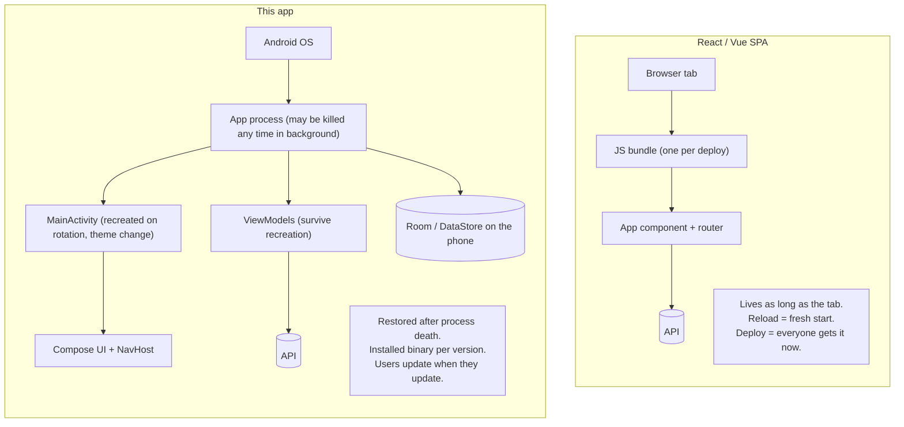
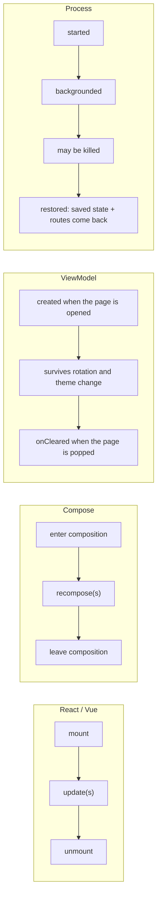

# 6. For React and Vue developers

How building this app compares with building a web app in React or Vue: the project layout, the same features written
three ways, a concept dictionary, and the places where Android works differently from the browser.

## The mental model shift



| Topic | Web SPA | This app |
| --- | --- | --- |
| Lifetime | one tab, until closed or reloaded | a process the OS may kill in the background and **restore** later, screen by screen |
| Config change | resize: same JS state | rotation, dark mode, language: the activity is **recreated**; ViewModels and saved state survive |
| Shipping | deploy, everyone has it on next load | a signed binary per version; old versions stay on phones for months |
| Data on device | `localStorage`, IndexedDB, small | SQLite (Room), DataStore files, encrypted secrets: offline-first is normal |
| Capabilities | browser APIs, permission prompts per site | camera, location, contacts, biometrics, notifications, background work, each declared in the manifest |
| UI toolkit | DOM + CSS | Compose: Kotlin functions, no HTML/CSS |

## Project layout side by side

A typical Vite app (React or Vue):

```text
my-web-app/
├── package.json            # dependencies + scripts
├── vite.config.ts          # build config
├── .env.development        # VITE_API_URL=…
├── src/
│   ├── main.tsx            # createRoot / createApp
│   ├── App.tsx             # providers + router outlet
│   ├── router/             # route table
│   ├── api/                # axios instance + interceptors
│   ├── stores/             # Zustand / Pinia
│   ├── components/         # shared UI
│   ├── features/products/  # pages, hooks, api calls of one feature
│   ├── locales/en.json, id.json
│   └── styles/tokens.css
└── tests/
```

This repository:

```text
kotlin-starter/
├── gradle/libs.versions.toml      # dependencies (package.json)
├── build-logic/                   # shared build config (vite/eslint/tsconfig presets)
├── gradle.properties              # version=1.0.0, build flags
├── app/                           # main.tsx + App.tsx + router: MainActivity, MainShell, AppNavHost
├── core/
│   ├── network/                   # axios instance: Retrofit/OkHttp, ApiError
│   ├── auth/                      # auth store + interceptors: session, bearer, 401 refresh
│   ├── datastore/                 # localStorage wrappers
│   ├── designsystem/              # components/ + styles/tokens: theme, AppButton, AppTextField…
│   ├── ui/                        # shared composite screens
│   └── common/                    # utils, i18n switch
├── feature/products/
│   ├── api/                       # the feature's public route types
│   └── impl/                      # pages, store (ViewModel), api calls, locales, tests
└── .github/workflows/             # CI + release
```

The biggest structural difference: in a web monorepo, "features" are usually folders that may import each other freely.
Here each feature is a separate Gradle module, so `feature/todos` **cannot** import from `feature/products/impl`; the
build refuses (chapter 1).

## Building a feature: the steps compared

| Step | React / Vue | This app |
| --- | --- | --- |
| Create the feature | a folder `src/features/orders` | two modules `feature/orders/api` + `impl` (skill `add-feature`) |
| Declare a page | add `{ path: '/orders/:id', element: <OrderPage/> }` / `{ path, component }` | `@Serializable data class OrderRoute(val id: Long)` in `:api`, `composable<OrderRoute> { … }` in `impl` |
| Page state | `useState`/`useReducer` + a store, or `ref`/`reactive` + Pinia | a `@HiltViewModel` with one `StateFlow<UiState>` |
| Fetch data | `useQuery` / `fetch` in a composable or store action | Retrofit interface + repository; ViewModel collects a `Flow` |
| Shared services | context providers / `provide` / module singletons | Hilt `@Inject` constructors, `@Module` bindings |
| UI | JSX / SFC template + CSS | composable functions + `Modifier` + design-system components |
| Text | `t('orders.title')` with JSON files | `stringResource(R.string.orders_title)` with `strings.xml` per locale |
| Tests | Vitest + Testing Library | JUnit + Robolectric + Compose testing |
| Ship | `vite build` + deploy | `assembleProdRelease` + signed upload to testers / Play |

## The same screen three ways

A todo list with an input, add and toggle. Simplified to the essentials in each.

**React** (component + store)

```tsx
// store.ts
export const useTodos = create<State>((set, get) => ({
  input: '',
  setInput: (input) => set({ input }),
  add: async () => {
    const title = get().input.trim()
    if (!title) return
    set({ input: '' })
    await db.todos.add({ id: crypto.randomUUID(), title, done: false, createdAt: Date.now() })
  },
  toggle: async (id) => {
    const todo = await db.todos.get(id)
    if (todo) await db.todos.update(id, { done: !todo.done })
  },
}))

// TodosPage.tsx
export function TodosPage() {
  const { input, setInput, add, toggle } = useTodos()
  const todos = useLiveQuery(() => db.todos.orderBy('createdAt').reverse().toArray()) ?? []
  return (
    <main>
      <input value={input} onChange={(e) => setInput(e.target.value)} />
      <button onClick={add}>Add</button>
      <ul>
        {todos.map((t) => (
          <li key={t.id} onClick={() => toggle(t.id)}>{t.title}</li>
        ))}
      </ul>
    </main>
  )
}
```

**Vue** (SFC + Pinia)

```vue
<script setup lang="ts">
import { useTodosStore } from '@/stores/todos'
const store = useTodosStore()        // state: todos, input; actions: add, toggle
</script>

<template>
  <main>
    <input v-model="store.input" />
    <button @click="store.add">Add</button>
    <ul>
      <li v-for="t in store.todos" :key="t.id" @click="store.toggle(t.id)">{{ t.title }}</li>
    </ul>
  </main>
</template>
```

**This app** (ViewModel + stateless screen + destination), abridged from the todos feature

```kotlin
// ViewModel = the store, scoped to this page's back-stack entry
@HiltViewModel
class TodosViewModel @Inject constructor(
    private val repository: TodosRepository,
    private val savedStateHandle: SavedStateHandle,
) : ViewModel() {
    val state: StateFlow<TodosUiState> =
        combine(savedStateHandle.getStateFlow("input", ""), repository.todos) { input, todos ->
            TodosUiState(input = input, todos = todos)
        }.stateIn(viewModelScope, SharingStarted.Eagerly, TodosUiState("", emptyList()))

    fun onInputChange(value: String) { savedStateHandle["input"] = value }

    fun add() {
        val title = state.value.input.trim()
        if (title.isEmpty()) return
        savedStateHandle["input"] = ""
        viewModelScope.launch { repository.add(title) }   // Room re-emits the list by itself
    }

    fun toggle(id: String) = viewModelScope.launch { repository.toggle(id) }
}

// Screen = presentational component: props in, callbacks out
@Composable
fun TodosScreen(state: TodosUiState, onInputChange: (String) -> Unit, onAdd: () -> Unit, onToggle: (String) -> Unit) {
    Column {
        AppTextField(value = state.input, onValueChange = onInputChange, label = "Task")
        AppButton("Add", onClick = onAdd)
        LazyColumn {
            items(state.todos, key = { it.id }) { todo ->
                Text(todo.title, Modifier.clickable { onToggle(todo.id) })
            }
        }
    }
}

// Destination = container: connects store and component, registered in the feature's navigation function
composable<TodosRoute> {
    val viewModel: TodosViewModel = hiltViewModel()
    val state by viewModel.state.collectAsStateWithLifecycle()
    TodosScreen(state, viewModel::onInputChange, viewModel::add, viewModel::toggle)
}
```

What to notice:

- `value` + `onValueChange` is a controlled input, exactly like React's `value` + `onChange`; Vue's `v-model` is the same
  pair written as one directive.
- `items(state.todos, key = { it.id })` is `.map(t => <li key={t.id}>)` / `v-for … :key`. `LazyColumn` only composes
  visible rows (like a virtualized list).
- The draft lives in `SavedStateHandle`, so after Android kills the app in the background and the user comes back, the
  half-typed text is still there. A web store loses it on reload unless you persist it yourself.
- There is no "refetch after mutation": Room's `Flow` re-emits, like Dexie's `liveQuery` or a subscription.

## The same API layer

**axios** (React or Vue)

```ts
export const http = axios.create({ baseURL: import.meta.env.VITE_API_URL })

http.interceptors.request.use((config) => {
  const token = auth.accessToken
  if (token && !config.anonymous) config.headers.Authorization = `Bearer ${token}`
  return config
})

let refreshing: Promise<string> | null = null
http.interceptors.response.use(undefined, async (error) => {
  if (error.response?.status !== 401 || error.config._retried) throw error
  refreshing ??= auth.refresh().finally(() => (refreshing = null))   // one refresh for all 401s
  error.config.headers.Authorization = `Bearer ${await refreshing}`
  error.config._retried = true
  return http(error.config)
})

export const searchProducts = (q: string, skip: number) =>
  http.get<ProductPage>('products/search', { params: { q, limit: 20, skip }, anonymous: true })
```

**This app**: the same three ideas, split by responsibility (chapter 3 has the real code)

```kotlin
// core:auth — request interceptor
class AuthInterceptor @Inject constructor(/* … */) : Interceptor {
    override fun intercept(chain: Interceptor.Chain): Response { /* add Bearer unless @Anonymous */ }
}
// core:auth — 401 handler, one shared refresh (SessionRefresher), retry once
class TokenAuthenticator @Inject constructor(/* … */) : Authenticator {
    override fun authenticate(route: Route?, response: Response): Request? { /* refresh, retry or give up */ }
}
// feature — endpoint declaration (types checked when parsing)
interface ProductsApi {
    @Anonymous @GET("products/search")
    suspend fun search(@Query("q") query: String, @Query("limit") limit: Int, @Query("skip") skip: Int): ProductPage
}
```

## The same routing

```ts
// React Router
const router = createBrowserRouter([
  { path: '/', element: <Home /> },
  { path: '/products', element: <Products /> },
  { path: '/products/:id', element: <ProductDetail /> },
  { path: '/account', element: <RequireAuth><Account /></RequireAuth> },
])

// Vue Router
const routes = [
  { path: '/products/:id', name: 'product', component: ProductDetail, props: true },
  { path: '/account', component: Account, meta: { requiresAuth: true } },
]
router.beforeEach((to) => (to.meta.requiresAuth && !auth.session ? { name: 'sign-in' } : true))
```

```kotlin
// This app: routes are types, each feature registers its own pages, :app composes them per tab
@Serializable data class ProductDetailRoute(val id: Long)

fun NavGraphBuilder.productsDestinations(navController: NavController) {
    composable<ProductsRoute> { /* … onOpen = { id -> navController.navigate(ProductDetailRoute(id)) } */ }
    composable<ProductDetailRoute> { /* … */ }
}
```

The auth guard is written in the destination (chapter 4, "Protected pages") rather than in a global `beforeEach`.

## Styling and theming

| Web | This app |
| --- | --- |
| CSS custom properties / Tailwind theme (`--color-primary`) | `AppColors` tokens in `core/designsystem/src/main/java/com/primestrider/kotlinstarter/core/designsystem/theme/AppColors.kt`, read with `LocalAppColors.current` / `MaterialTheme.colorScheme` |
| `prefers-color-scheme` + `.dark` class | `AppTheme(darkTheme)`; the user's choice stored in DataStore, applied before the first frame |
| spacing scale (`p-4`, `gap-2`) | `Spacing.s4`, `Radii.xl` objects |
| component library (MUI, Vuetify, shadcn) | `core:designsystem` components (`AppButton`, `AppTextField`, `AppCheckbox`, …); stock Material form controls are forbidden by a test |
| `className` / `:class` / inline styles | `Modifier.padding(…).background(…).clickable { … }` chains |
| Storybook | the Components and Styling pages of the catalog example, plus Roborazzi screenshots |

## Concept dictionary

| React | Vue | This app (Kotlin / Compose / Android) |
| --- | --- | --- |
| component (function returning JSX) | SFC component | `@Composable` function |
| props | props | function parameters |
| callback props (`onClick`) | `emit('click')` | lambda parameters (`onClick: () -> Unit`) |
| `useState` | `ref` | `remember { mutableStateOf(…) }` (`rememberSaveable` to survive rotation/process death) |
| `useMemo` | `computed` | `remember(key) { … }`, `derivedStateOf`, or `combine` in the ViewModel |
| `useEffect` | `watch`, `onMounted`/`onUnmounted` | `LaunchedEffect(key)`, `DisposableEffect(key) { onDispose { } }` |
| re-render | reactivity update | recomposition |
| Context | `provide` / `inject` | `CompositionLocal` (UI values), Hilt (services) |
| Redux / Zustand store | Pinia store | ViewModel + `StateFlow` (per page), repositories (shared) |
| selector / `createSelector` | getter / `computed` | `combine` / `map` on flows |
| RxJS observable, async iterator | — | Kotlin `Flow` |
| `async`/`await`, `AbortController` | same | `suspend` functions, coroutines; cancellation is automatic with the scope |
| React Router / TanStack Router | Vue Router | Navigation Compose with `@Serializable` routes |
| route params | `route.params` | route class fields, `toRoute<…>()` |
| axios / fetch + interceptors | same | Retrofit + OkHttp `Interceptor` / `Authenticator` |
| TanStack Query cache | Pinia + cache | repository + Room (as cache) / Paging |
| infinite query | `useInfiniteScroll` | Paging 3 (`Pager`, `LazyPagingItems`) |
| zod schema | zod / valibot | `@Serializable` data classes (kotlinx serialization) |
| `localStorage` | same | DataStore Preferences |
| IndexedDB / Dexie | same | Room (SQLite) |
| i18next (`t('key')`) | vue-i18n (`$t('key')`) | `stringResource(R.string.key)`, `values/` + `values-in/` |
| `import.meta.env.VITE_*` | same | `BuildConfig` fields from flavours |
| `package.json` | same | `gradle/libs.versions.toml` + module `build.gradle.kts` |
| npm scripts / Vite | same | Gradle tasks |
| pnpm workspaces / Nx | same | Gradle modules (`settings.gradle.kts`) |
| ESLint / Prettier | same | Android Lint / ktlint |
| Vitest + Testing Library | Vitest + Vue Test Utils | JUnit + Robolectric + Compose UI test |
| Storybook / Chromatic | same | catalog pages / Roborazzi |
| Error Boundary | `errorCaptured` | `CrashRecorder` + `CrashFallbackScreen` (next launch) |
| Service Worker / Web Push | same | WorkManager / notifications |
| Vercel deploy | Netlify deploy | signed APK → Firebase App Distribution (later Play) |

## Lifecycles compared



A composable's `remember` state is like component state: gone when it leaves the composition. A ViewModel is like a
store scoped to one history entry. `rememberSaveable` and `SavedStateHandle` are the only things that survive the OS
killing the process, so anything the user typed belongs there.

## Pitfalls when coming from the web

- **Do not keep screen data in a composable.** Fetching inside a composable (like `useEffect(() => fetch…)`) refetches on
  every rotation. Put it in the ViewModel; the screen only renders `state`.
- **Assume process death.** Test with "Don't keep activities" (developer options) or rotate a lot. Arguments travel in
  the route, drafts in `SavedStateHandle`.
- **Strings are resources, not literals.** Every user-visible text goes to `strings.xml` in both locales; tests fail
  otherwise.
- **The main thread must not block.** Network and disk run in `suspend` functions (Retrofit and Room switch threads for
  you); `runBlocking` in UI code freezes the app.
- **Permissions are declared and asked.** A web prompt per feature becomes a manifest entry plus a runtime request with
  denied/blocked states (`PermissionGate`).
- **A release is permanent.** You cannot hot-fix a phone; that is why CI checks the minified release, the signature and
  the version before anything ships.

Next: [Cookbook: UI patterns side by side](07-ui-patterns-cookbook.md).
