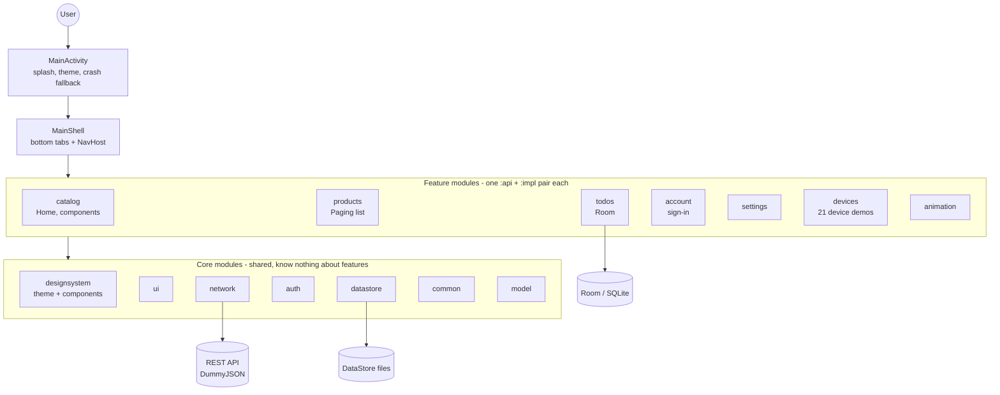

# Learning guide

A guided tour of this repository for developers and maintainers who are new to it, or new to Android. Read the
chapters in order the first time. Each chapter walks through real code from the repository, quoted and explained
line by line, with diagrams of how the pieces call each other.

The reference docs in `docs/architecture/` answer "how exactly does X work". This guide answers "how do the pieces fit
together, and why are they shaped like this", and links into the reference docs instead of repeating them.

| # | Chapter | You will understand |
| --- | --- | --- |
| 1 | [The big picture](01-the-big-picture.md) | what the app is, the module map, the rules that keep it apart |
| 2 | [From launch to pixels](02-from-launch-to-pixels.md) | app start, Compose, the Screen / ViewModel split, state flowing one way |
| 3 | [Data, network and auth](03-data-network-auth.md) | repositories, Retrofit, Room, DataStore, the session and token refresh |
| 4 | [Navigation](04-navigation.md) | routes, the tab shell, how features plug into it, deep links |
| 5 | [Build, test and ship](05-build-test-ship.md) | Gradle and build-logic, flavours, tests, CI, releases |
| 6 | [For React and Vue developers](06-for-react-and-vue-developers.md) | every concept mapped to what you already know, with side-by-side code |

Web developers: chapter 6 works as a dictionary. Read chapter 1, then keep chapter 6 open next to chapters 2-5.

## The whole app on one page

## Words you will meet

| Term | Meaning here |
| --- | --- |
| Composable | A Kotlin function annotated `@Composable` that describes UI. The Compose runtime calls it again (recomposes) when the state it read changes. |
| ViewModel | A state holder that survives screen rotation; exposes one `StateFlow` of UI state. |
| `StateFlow` | An observable value that always has a current value (think a store slice you can subscribe to). |
| Hilt | Dependency injection: classes ask for what they need in their constructor, Hilt builds and passes it. |
| Route | A `@Serializable` Kotlin object/class that names a screen (and carries its arguments). |
| Module | A Gradle subproject (`:core:network`, `:feature:products:impl`). Dependencies between modules are declared, so forbidden imports do not compile. |
| Flavour | A build variant of the app (`dev`, `prod`) with its own id, API URL and deep-link scheme. |
| Robolectric | Runs Android code, including Compose UI, on the JVM so tests do not need a device. |
